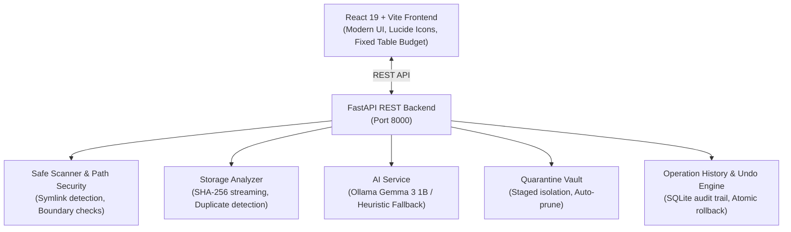

<div align="center">

# 🗂️ FileNest AI

**Intelligent, Local-First Windows File Organizer & Storage Optimization Platform**

[](https://fastapi.tiangolo.com)
[](https://react.dev)
[](https://vitejs.dev)
[](https://www.python.org)
[](https://ollama.ai)
[](LICENSE)

*Safely organize, analyze, and declutter your drives with local AI intelligence, cryptographic duplicate detection, reversible quarantine vaults, and atomic rollback safeguards.*

---

</div>

## 🌟 Overview

**FileNest AI** is a professional desktop-grade application designed to solve drive clutter, duplicate sprawl, and unstructured folders on Windows. 

Unlike traditional file sorters that perform opaque or destructive actions, FileNest AI operates on a **strict local-first, safety-first philosophy**:
- **Zero Cloud Exposure:** All scanning, hashing, analysis, and AI reasoning execute entirely on your machine.
- **Review Before Execution:** Every organization plan and cleanup recommendation requires explicit user approval.
- **Fail-Safe Rollback:** All operations are recorded in an atomic SQLite audit trail and can be undone with a single click.

---

## ✨ Key Features

### 🧠 1. AI-Powered & Rule-Based File Organization
- **Local AI Classification:** Integrates with local **Ollama (Gemma 3 1B)** to understand document contexts and propose logical folder hierarchies.
- **Deterministic Rule Fallback:** Instantly organizes thousands of files using high-speed extension heuristics when AI is offline.
- **Interactive Plan Inspector:** Review proposed destinations, toggle individual moves, edit destination folders, and execute moves in atomic batches.

### 🔍 2. Cryptographic Storage Analytics & Duplicate Detection
- **Chunked SHA-256 Verification:** Verifies duplicate candidates using stream-based SHA-256 hashing without consuming excess RAM.
- **Wasted Space Identification:** Calculates potential reclaimed storage and displays verified duplicate groups side-by-side.
- **Largest Files & Folder Insights:** Visual breakdown of space consumption by file type and directory depth.

### 🛡️ 3. Safe Quarantine Vault & Smart Cleanup
- **Non-Destructive Cleanup:** Never deletes files directly during cleanup. Selected clutter is staged into a workspace-isolated `.filenest_quarantine` vault.
- **One-Click Restore:** Quarantined files can be reviewed in the Quarantine Vault and restored to their original location with a single click.
- **Auto-Pruning:** The quarantine directory is automatically pruned from disk when emptied.

### ⏪ 4. Atomic Activity History & Undo
- **Persistent SQLite Audit Trail:** Logs operation type, source path, destination path, timestamps, and status for every movement and quarantine action.
- **Clean Ancestor Pruning:** When an organization move is undone, any empty category subfolders created during organization are automatically removed.
- **Copy Path Utilities:** Quickly copy paths and inspection metadata for auditing.

### 🔒 5. Workspace Containment & System Safety
- **Strict Drive Boundary Enforcement:** Operations are strictly constrained to the user-approved workspace. Path traversal (`../`) and symbolic-link exploits are blocked.
- **System Directory Protection:** Hardcoded guardrails prevent scanning or modifying critical Windows paths (`C:\Windows`, `Program Files`, `System32`, root drive volumes).
- **Custom Protected Rules:** Mark critical files or entire folders as "Protected" to exclude them from organization and cleanup suggestions.

---

## 🏗️ System Architecture



---

## 🚀 Getting Started

### Prerequisites
1. **Python 3.11+** installed ([python.org](https://www.python.org/downloads/))
2. **Node.js 18+** & npm installed ([nodejs.org](https://nodejs.org/))
3. *(Optional)* **Ollama** running locally with `gemma3:1b` for AI-assisted organization:
   ```bash
   ollama run gemma3:1b
   ```

---

### 1. Clone the Repository
```bash
git clone https://github.com/SamruddhiPatil0078/FileNestAI.git
cd FileNestAI
```

### 2. Backend Setup
```powershell
cd backend

# Create and activate Python virtual environment
python -m venv .venv
.\.venv\Scripts\Activate.ps1

# Install dependencies
pip install -r requirements.txt

# Run FastAPI backend server (port 8000)
uvicorn app.main:app --host 127.0.0.1 --port 8000 --reload
```
The API documentation is accessible at `http://localhost:8000/docs`.

### 3. Frontend Setup
Open a new terminal window:
```powershell
cd frontend

# Install Node dependencies
npm install

# Start Vite dev server (port 5173)
npm run dev
```
Open **`http://localhost:5173`** in your browser.

---

## 🧪 Testing & Verification

FileNest AI includes an automated test suite covering path security, duplicate verification, batch moves, quarantine lifecycle, and atomic rollback.

To run the full test suite:
```powershell
cd backend
$env:PYTHONPATH="E:\FileNestAI\backend"
.\.venv\Scripts\python -m pytest tests -v
```
*(All 47 unit and integration tests passing).*

---

## 📂 Project Structure

```
FileNestAI/
├── backend/
│   ├── app/
│   │   ├── main.py                  # FastAPI route controllers
│   │   └── services/
│   │       ├── ai_service.py        # Ollama local LLM integration & prompt engineering
│   │       ├── cleanup_service.py   # Heuristic cleanup suggestions & rule protection
│   │       ├── file_operations.py   # Path validation, single & batch file movements
│   │       ├── operation_history.py # SQLite database persistence for operations
│   │       ├── path_security.py     # Windows folder dialog & system path deny-listing
│   │       ├── quarantine_service.py# Staged quarantine vault, restore & auto-prune
│   │       ├── scanner.py           # Recursive filesystem traversal with symlink safety
│   │       ├── storage_analyzer.py  # Streamed SHA-256 duplicate detection & analytics
│   │       └── undo_service.py      # Atomic move rollback & ancestor pruning
│   ├── tests/                       # 47 comprehensive pytest test suites
│   └── requirements.txt             # Python dependencies (FastAPI, Uvicorn, etc.)
│
├── frontend/
│   ├── src/
│   │   ├── components/              # Sidebar, TopBar, WelcomeScreen, ConfirmModal
│   │   ├── pages/
│   │   │   ├── DashboardPage.jsx    # Overview metrics, charts, quick actions
│   │   │   ├── AnalyticsPage.jsx    # Storage breakdown & duplicate resolution
│   │   │   ├── CleanupPage.jsx      # Smart cleanup & multi-file quarantine workflow
│   │   │   ├── AssistantPage.jsx    # AI organization plan inspector & executor
│   │   │   ├── ExplorerPage.jsx     # Discovered files search & filter table
│   │   │   ├── QuarantinePage.jsx   # Safe quarantine vault with one-click restore
│   │   │   ├── HistoryPage.jsx      # Audit trail & atomic undo actions
│   │   │   └── ProtectedPage.jsx    # User-defined protection rules manager
│   │   ├── utils/                   # Byte and timestamp formatters
│   │   ├── api.js                   # REST API client
│   │   ├── App.jsx                  # Main application orchestrator & toast provider
│   │   └── index.css                # Polished design system tokens and responsive layout
│   ├── package.json                 # Node dependencies (React 19, Lucide, Vite)
│   └── vite.config.js               # Vite build configuration
│
├── sample_files/                    # Realistic test files for validation
└── README.md                        # Documentation
```

---

## 🔒 Safety Guarantees

1. **Explicit Confirmation:** No filesystem modifications occur without user approval via confirmation modals.
2. **Never Overwrite:** If a file with the destination name already exists, the operation aborts to prevent data loss.
3. **No Direct Deletes During Cleanup:** Smart cleanup moves files to `.filenest_quarantine` so accidental actions can always be restored.
4. **Clean Rollbacks:** Undoing batch file organization restores original locations and automatically removes any empty subfolders created in the process.

---

## 📄 License

This project is licensed under the [MIT License](LICENSE).
